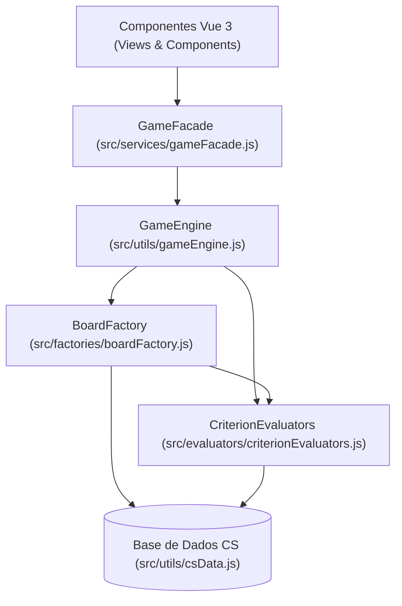

# 🎯 Clutch Taka Toe — Counter-Strike Trivia Grid

<p align="center">
  
  
  
  
  
</p>

> **Clutch Taka Toe** é um jogo de navegador inspirado no clássico *Tiki-Taka-Toe* (jogo da velha de futebol), adaptado para o cenário competitivo de **Counter-Strike (CS 1.6, CS:GO e CS2)** com identidade visual inspirada na **HLTV.org**.

---

## 📌 Sobre o Projeto

Em uma grade **3 × 3**, cada linha e cada coluna apresenta um critério histórico do cenário profissional de Counter-Strike (organizações, nacionalidades, títulos de Major, IEM Katowice, IEM Cologne, Intel Grand Slam, HLTV Top 20/Top 1, treinadores ou ex-companheiros de equipe). Para dominar uma casa do tabuleiro, o jogador (**CT** ou **TR**) precisa indicar um *pro player* que atenda **simultaneamente** ao critério da linha e ao da coluna correspondente.

### Principais Funcionalidades

- **Dois Modos de Jogo**:
  - **Mesma Tela (PvP Local)**: Dois jogadores alternam turnos entre **CT** e **TR** no mesmo dispositivo.
  - **Contra o Bot (PvE)**: Enfrente uma IA que analisa o tabuleiro para bloquear linhas de vitória, buscar sequências próprias e roubar casas, em três níveis de precisão (**Fácil — 40%**, **Médio — 70%** e **Difícil — 95%**).
- **Mecânica de Roubo de Casas (*Steals*)**: Cada lado possui até **3 roubos** por partida para tomar uma casa já dominada pelo adversário citando outro jogador válido para aquele cruzamento.
- **Gerador Inteligente de Tabuleiros Solucionáveis**: O sistema sorteia e valida matematicamente todas as 9 interseções da grade 3 × 3, garantindo que toda partida gerada possua respostas válidas em todas as células.
- **Gabarito Pós-Partida Completo**: Ao término da rodada (por vitória, empate ou desistência), o painel estilo HLTV revela todos os jogadores válidos possíveis para cada uma das 9 casas.
- **Base de Dados Auditada e Simétrica**:
  - **220 jogadores profissionais** históricos e atuais (CS 1.6, CS:GO e CS2).
  - **81 critérios** divididos em **34 organizações**, **21 países**, **9 conquistas**, **6 treinadores lendários** e **11 duplas/companheiros**.
  - Grafo de companheiros de equipe (`teammates`) gerado a partir de lineups reais com **100% de simetria** ($A \in B \iff B \in A$).

---

## 🏗️ Arquitetura e Padrões de Projeto (Engenharia de Software)

O projeto foi estruturado aplicando princípios **SOLID** e padrões de projeto clássicos (**GoF**), separando a interface reativa (Vue 3) das regras de negócio e da geração de dados:



| Padrão | Arquivo | Responsabilidade |
| :--- | :--- | :--- |
| **Facade** | `src/services/gameFacade.js` | Centraliza o estado reativo da partida, áudio (Web Audio API), turnos da IA, modais e ações do usuário em uma interface limpa para os componentes Vue. |
| **Factory Method** | `src/factories/boardFactory.js` | Encapsula o sorteio de estratégias de linhas/colunas, prevenção de conflitos lógicos e validação de solucionabilidade das 9 casas do tabuleiro 3 × 3. |
| **Strategy (OCP)** | `src/evaluators/criterionEvaluators.js` | Avalia cada tipo de critério (`team`, `nationality`, `teammate`, `coach`, `achievement`) de forma desacoplada e extensível (*Open/Closed Principle*). |

---

## 📂 Estrutura de Pastas

```text
Clutch-Taka-Toe/
├── index.html
├── package.json
├── vite.config.js
└── src/
    ├── App.vue
    ├── main.js
    ├── style.css                        # Design tokens inspirados no HLTV Dark Mode
    ├── assets/                          # Escudos de organizações, bandeiras SVG, fotos e troféus
    ├── components/
    │   ├── BaseDialog.vue               # Modal acessível reutilizável
    │   ├── BrandMark.vue                # Identidade visual do projeto
    │   ├── CriterionHeader.vue          # Cabeçalho visual das linhas e colunas da grade
    │   ├── CsImage.vue                  # Renderizador de imagens com fallback automático
    │   ├── FilledCell.vue               # Card de jogador preenchido no padrão de lineup da HLTV
    │   ├── GameBoard.vue                # Tabuleiro principal 3x3 + controles de turno
    │   ├── GameSetup.vue                # Seleção de modo (PvP / Bot) e estatísticas da base
    │   ├── GameSummaryModal.vue         # Gabarito pós-partida com todos os jogadores válidos
    │   ├── PlayerSearchModal.vue        # Busca com autocomplete, navegação por teclado e validação
    │   ├── RulesDialog.vue              # Modal de regras do jogo
    │   ├── ScoreBoard.vue               # Placar CT vs TR, indicador de roubos e status do turno
    │   └── StealPips.vue                # Indicador visual de roubos restantes
    ├── evaluators/
    │   └── criterionEvaluators.js       # Strategy Pattern para validação de critérios
    ├── factories/
    │   └── boardFactory.js              # Factory Method para criação e validação de tabuleiros
    ├── services/
    │   └── gameFacade.js                # Facade Pattern orquestrando estado, som e IA
    ├── utils/
    │   ├── csData.js                    # Base de dados com 220 jogadores e 81 critérios
    │   ├── gameEngine.js                # Motor de validação de jogadas e verificação de vitória
    │   └── uiHelpers.js                 # Utilitários de formatação visual
    └── views/
        └── home.vue                     # Layout principal da aplicação
```

---

## 🚀 Como Executar Localmente

### Pré-requisitos
- **Node.js** (versão 18 ou superior)
- **npm**

### Passo a passo

```bash
# 1. Clone o repositório
git clone https://github.com/grilocaio/Clutch-Taka-Toe.git

# 2. Acesse a pasta do projeto
cd Clutch-Taka-Toe

# 3. Instale as dependências
npm install

# 4. Inicie o servidor de desenvolvimento
npm run dev
```

Acesse `http://localhost:5173/` no navegador.

Para gerar a versão otimizada de produção:

```bash
npm run build
npm run preview
```

---

## 👨‍💻 Autor

Desenvolvido por **Caio Grilo**  
- GitHub: [@grilocaio](https://github.com/grilocaio)
- LinkedIn: [Caio Grilo](https://www.linkedin.com/in/caio-grilo/)
